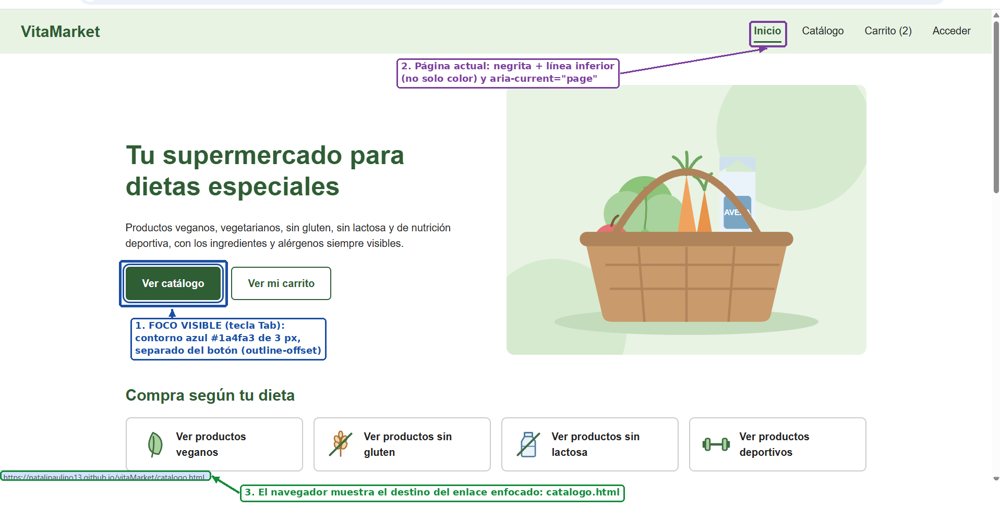
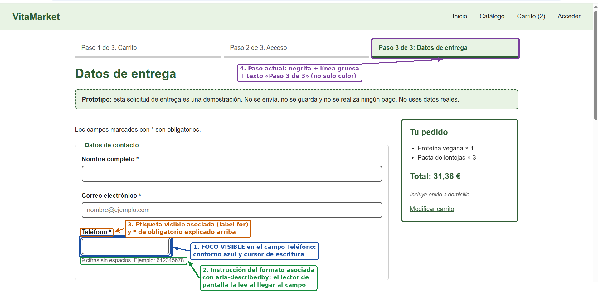
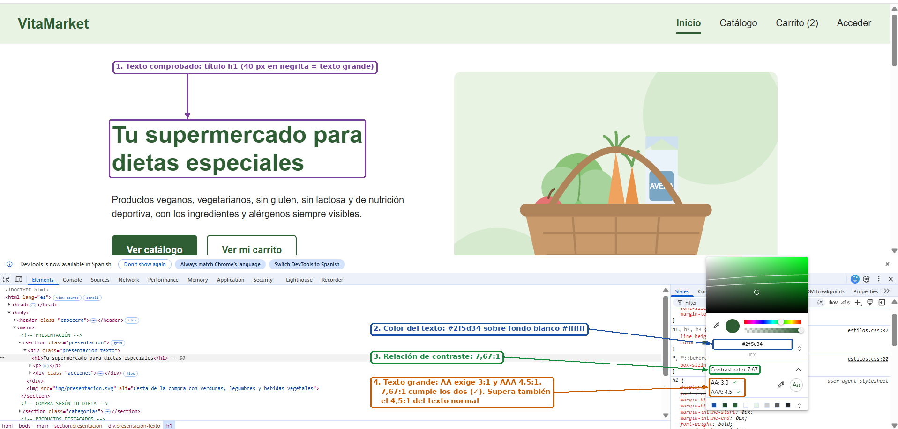
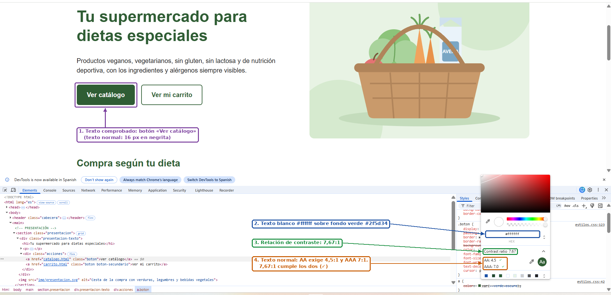
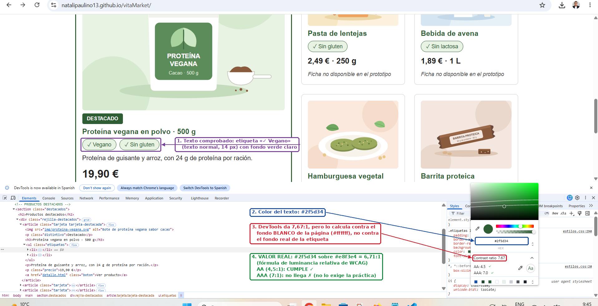
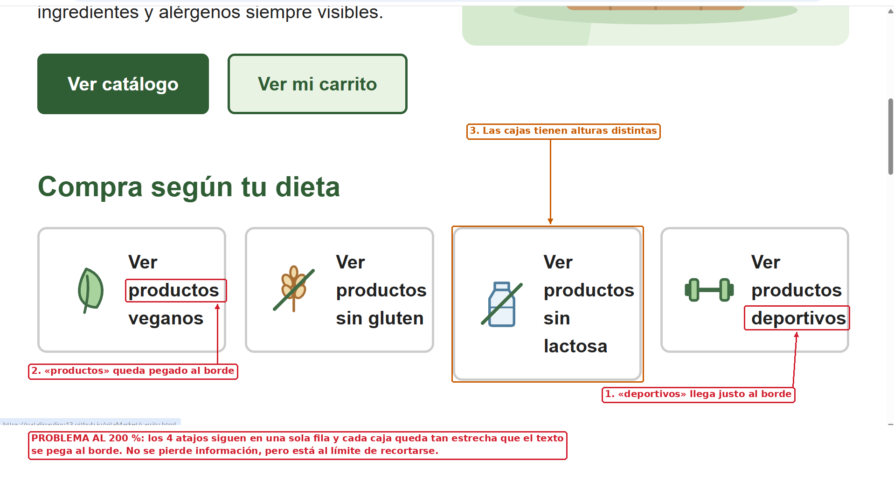
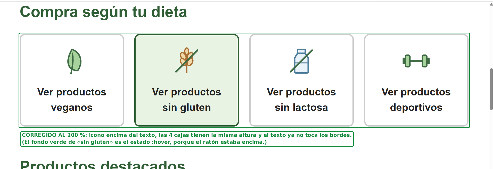
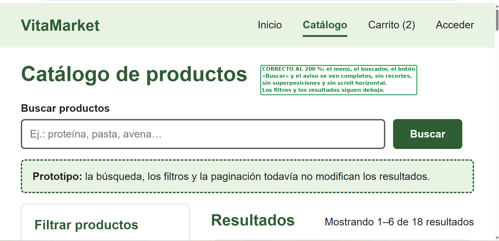
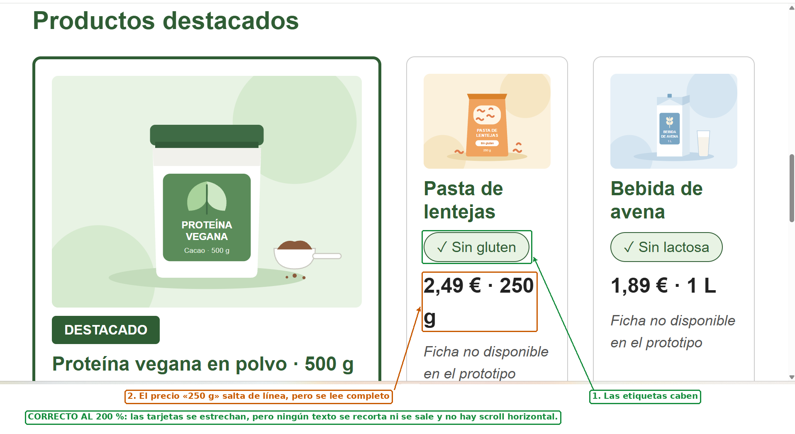
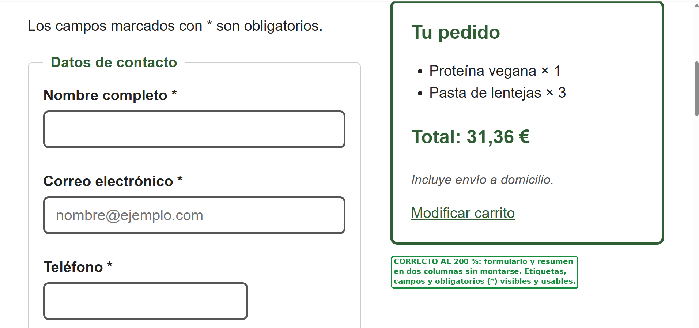

# Comprobación de accesibilidad

Revisión parcial realizada sobre la web publicada en GitHub Pages con Google Chrome. No permite afirmar que la web cumple WCAG A, AA o AAA.

## Tabla de comprobación

| Aspecto | Página o elemento revisado | Método utilizado | Resultado | Corrección realizada o problema pendiente |
|---|---|---|---|---|
| Estructura: idioma | Las 6 páginas | Revisión del código | Todas tienen `lang="es"` | Ninguna |
| Estructura: título | Las 6 páginas | Revisión del código y pestaña del navegador | Cada página tiene un `<title>` descriptivo y distinto | Ninguna |
| Estructura: encabezados | Las 6 páginas | Revisión del código | Un solo `h1` por página y sin saltos de nivel (h1 → h2 → h3) | Ninguna |
| Imágenes | Las 6 páginas | Revisión del código | Las imágenes informativas tienen `alt` descriptivo. Los iconos de «Compra según tu dieta» y las imágenes del carrito tienen `alt=""` porque el texto de al lado ya da la información | Ninguna |
| Formularios: etiquetas | Catálogo, detalle, carrito, acceso y formulario | Revisión del código y clic en cada etiqueta | Todos los campos tienen `<label for>` visible y asociado. Al pulsar la etiqueta se activa el campo | Ninguna |
| Formularios: agrupaciones e instrucciones | Catálogo y formulario | Revisión visual y del código | Filtros y formulario agrupados con `fieldset` y `legend`. Teléfono, código postal, fecha e instrucciones tienen indicación asociada con `aria-describedby`. El `placeholder` solo es un ejemplo, nunca sustituye a la etiqueta | Ninguna |
| Teclado | Las 6 páginas y recorrido completo de compra | Navegación solo con Tab, Mayús + Tab, Enter, Espacio y flechas | Se llega a todos los enlaces, botones y campos, y se pueden usar. No hay trampas de teclado | Ninguna |
| Foco | Las 6 páginas | Navegación con Tab | El foco se ve siempre (contorno azul `#1a4fa3` de 3 px; blanco en el pie, sobre fondo oscuro). El orden sigue el orden de lectura | Ninguna |
| Contraste | Textos y fondos de las 6 páginas | DevTools (selector de color, *Contrast ratio*) y cálculo con la fórmula de WCAG cuando DevTools no detectó el fondo | Todas las combinaciones superan 4,5:1 (ver tabla de contraste). La más baja es la etiqueta de características: 6,71:1 | Ninguna. DevTools calculaba la etiqueta contra el fondo blanco; se calculó con sus colores reales |
| Uso del color | Menú, pasos del pedido, paginación y etiquetas | Revisión visual | La página y el paso actuales se marcan con negrita y línea, no solo con color. Las etiquetas llevan ✓ y texto | Ninguna |
| Ampliación al 200 % | Las 6 páginas | Zoom del navegador al 200 % (Ctrl + +) y recorrido de cada página hasta el pie | Se puede usar todo sin scroll horizontal ni superposiciones. En «Compra según tu dieta» (inicio), el texto de los 4 atajos quedaba pegado al borde de la caja y las cajas tenían alturas distintas | **Corregido:** el icono se coloca encima del texto (`flex-direction: column`) y el enlace ocupa toda la altura del `li`, así las 4 cajas tienen la misma altura y el texto dispone de todo el ancho |

## Evidencias

### Teclado y foco

### Contraste

Mínimo exigido: 4,5:1 para texto normal y 3:1 para texto grande (al menos 24 px, o unos 18,7 px en negrita).

| Texto | Fondo | Dónde se usa | Relación | Resultado |
|---|---|---|---|---|
| `#222222` | `#ffffff` | Texto normal | 15,91:1 | Cumple |
| `#222222` | `#e8f3e4` | Menú de la cabecera y avisos de prototipo | 13,92:1 | Cumple |
| `#555555` | `#ffffff` | Instrucciones, disponibilidad y textos secundarios | 7,46:1 | Cumple |
| `#2f5d34` | `#ffffff` | Títulos y enlaces | 7,67:1 | Cumple |
| `#2f5d34` | `#e8f3e4` | Etiquetas, logo y página actual del menú | 6,71:1 | Cumple |
| `#ffffff` | `#2f5d34` | Botones y pie de página | 7,67:1 | Cumple |
| `#ffffff` | `#24482a` | Botones al pasar el ratón | 10,32:1 | Cumple |
| `#1a4fa3` | `#ffffff` | Contorno del foco | 7,80:1 | Cumple (mínimo 3:1 para elementos que no son texto) |

### Ampliación al 200 %

**Problema detectado** en «Compra según tu dieta»: el texto queda pegado al borde y las cajas tienen alturas distintas.

**Corrección:** icono encima del texto y cajas de la misma altura.

**Resto de páginas:** sin problemas. Las tarjetas se estrechan y los textos saltan de línea, pero no se recorta ni se pierde nada.

