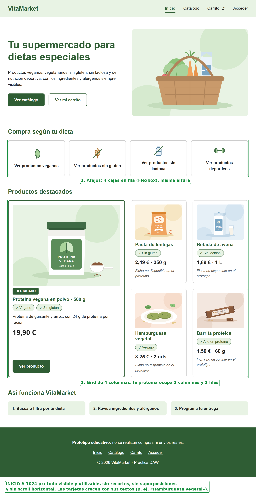
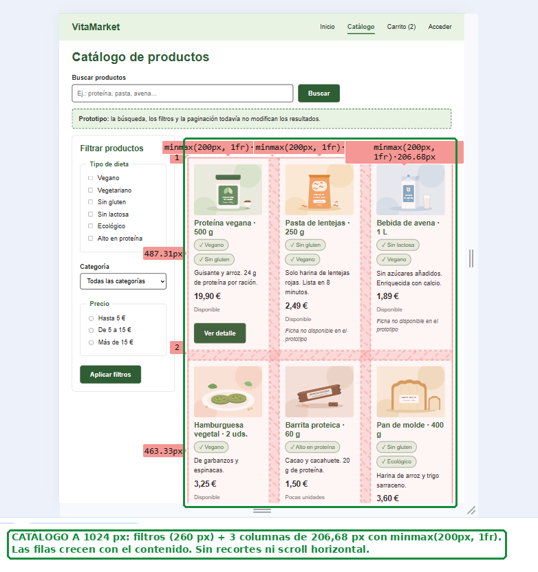
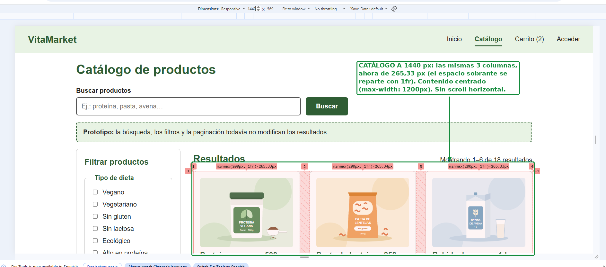
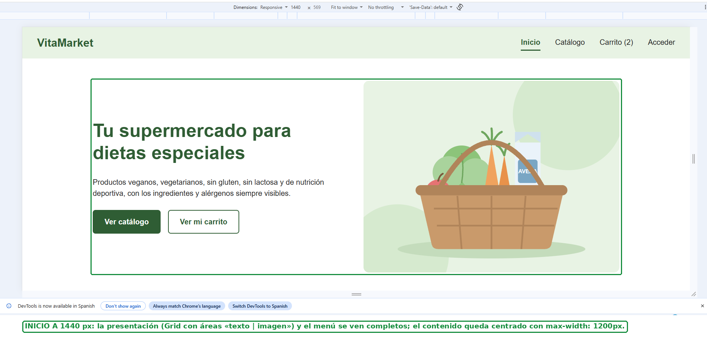

# Comprobación a 1024 y 1440 px

Comprobación realizada en la web publicada con el modo de diseño adaptable de DevTools (Chrome), con un área de visualización de 1024 × 768 px y de 1440 × 768 px.

| Comprobación | 1024 px | 1440 px |
|---|---|---|
| Contenidos y controles visibles y utilizables | ✅ | ✅ |
| Sin superposiciones ni recortes | ✅ | ✅ |
| Sin desplazamiento horizontal de la página | ✅ | ✅ |
| Las cajas crecen con sus textos | ✅ | ✅ |

**Cómo se aprovecha el espacio:**

- El contenido tiene un ancho máximo de 1200 px y queda centrado (`max-width` + `margin: 0 auto`), así que a 1440 px las líneas de texto no se alargan demasiado.
- **Catálogo:** `repeat(auto-fill, minmax(200px, 1fr))` da 3 columnas en las dos anchuras: de 206,68 px a 1024 px y de 265,33 px a 1440 px. El espacio sobrante se reparte con `1fr`.
- **Productos destacados:** Grid de 4 columnas en las dos anchuras. La tarjeta de la proteína ocupa 2 columnas y 2 filas.
- **Compra según tu dieta:** los 4 atajos en fila con Flexbox (`flex: 1`), todos con la misma altura.
- La altura de las filas y tarjetas no está fijada: crece con el contenido, como en «Hamburguesa vegetal», cuyo título ocupa dos líneas.

No ha sido necesario cambiar el número de columnas ni reorganizar la navegación entre las dos anchuras.

## Evidencias

