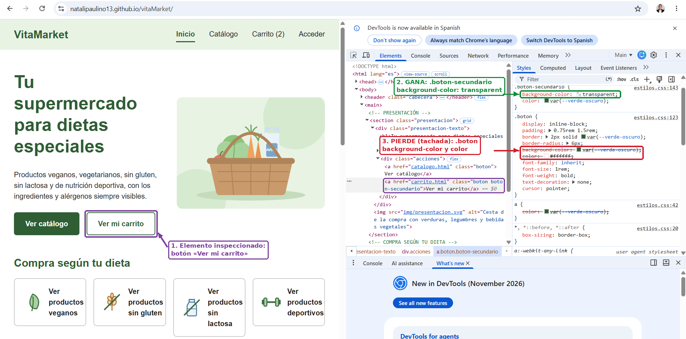
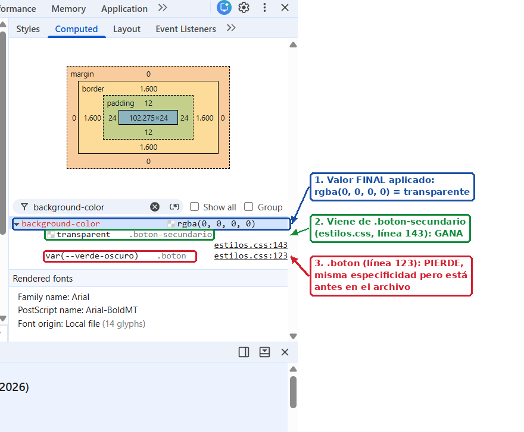
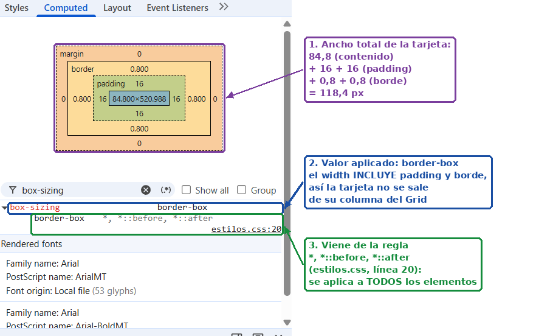
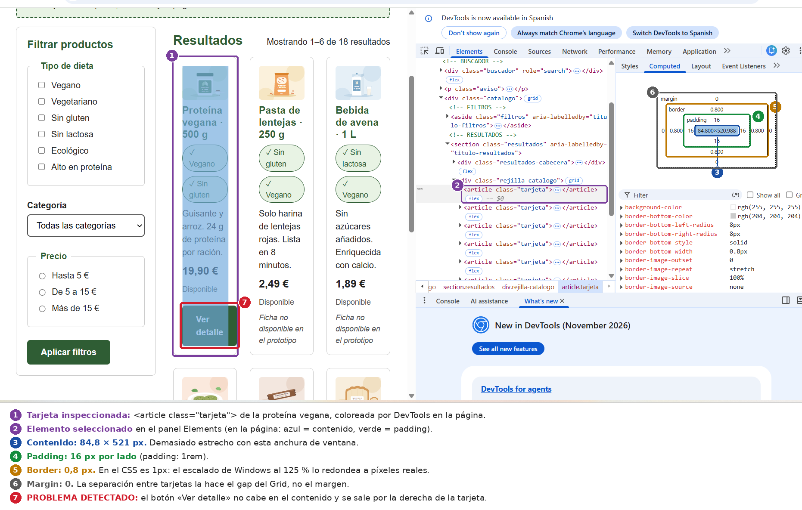
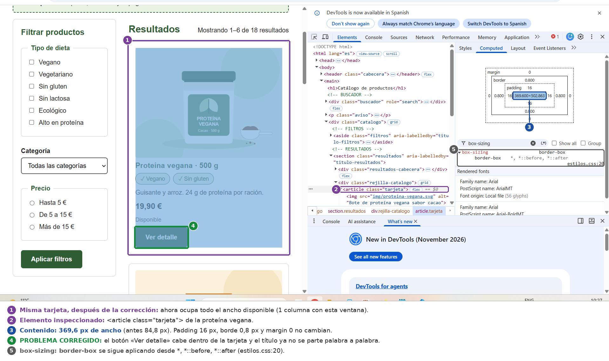

# Comprobaciones con DevTools

Comprobaciones realizadas en Google Chrome sobre la web publicada en GitHub Pages.

## 1. Regla sobrescrita (cascada)

**Elemento:** botón «Ver mi carrito» de la página de inicio (`<a class="boton boton-secundario">`).

**Qué he comprobado:** el botón tiene dos clases y las dos reglas definen `background-color` y `color`:

- `.boton` (línea 123): fondo `var(--verde-oscuro)` y texto blanco.
- `.boton-secundario` (línea 143): fondo `transparent` y texto `var(--verde-oscuro)`.

Las dos reglas tienen la **misma especificidad** (una clase), así que gana la que aparece **más abajo** en la hoja de estilos: `.boton-secundario`. En el panel *Styles*, las propiedades de `.boton` aparecen tachadas. En *Computed*, el valor final de `background-color` es `rgba(0, 0, 0, 0)` (transparente) y procede de `.boton-secundario`.

También aparece tachado `color` en la regla `a`: pierde porque un selector de clase es **más específico** que un selector de etiqueta.

**Conclusión:** la variante `.boton-secundario` reutiliza todos los estilos de `.boton` (tamaño, borde, tipografía) y solo sobrescribe el fondo y el color del texto.

## 2. Modelo de caja de un componente

**Elemento:** tarjeta de producto del catálogo (`<article class="tarjeta">`, proteína vegana).

**Qué he comprobado:** en el panel *Computed*, el diagrama del modelo de caja muestra:

- **Padding:** 16 px por cada lado (`padding: 1rem`).
- **Border:** 1 px en el CSS. DevTools muestra 0,8 px porque el escalado de pantalla de Windows está al 125 % y el navegador redondea el borde a píxeles reales.
- **Margin:** 0. La separación entre tarjetas la hace el `gap` del Grid, no el margen.
- **box-sizing: border-box**, aplicado a todos los elementos con la regla `*, *::before, *::after` (línea 20). El ancho de la tarjeta incluye el padding y el borde, así que la tarjeta siempre ocupa exactamente su columna del Grid y no se sale de ella.

**Problema detectado:** con una ventana estrecha (DevTools abierto, unos 760 px), el catálogo mantenía 3 columnas y el contenido de cada tarjeta medía solo **84,8 px**. El botón «Ver detalle» no cabía y se salía de la tarjeta. Este problema también aparecería en la prueba de ampliación al 200 %.

**Corrección realizada:** en `.rejilla-catalogo` he cambiado

`grid-template-columns: repeat(3, minmax(0, 1fr));`

por

`grid-template-columns: repeat(auto-fill, minmax(200px, 1fr));`

Ahora cada columna mide como mínimo 200 px y el navegador coloca tantas columnas como quepan. A 1024 y 1440 px se siguen viendo 3 columnas, y en anchuras pequeñas las tarjetas bajan a la siguiente fila en lugar de estrecharse.

**Resultado:** el contenido de la tarjeta pasa a medir 369,6 px con la misma ventana, y el botón y el título caben sin desbordarse.

## 3. Distribución con Grid en el inspector

*(Pendiente)*