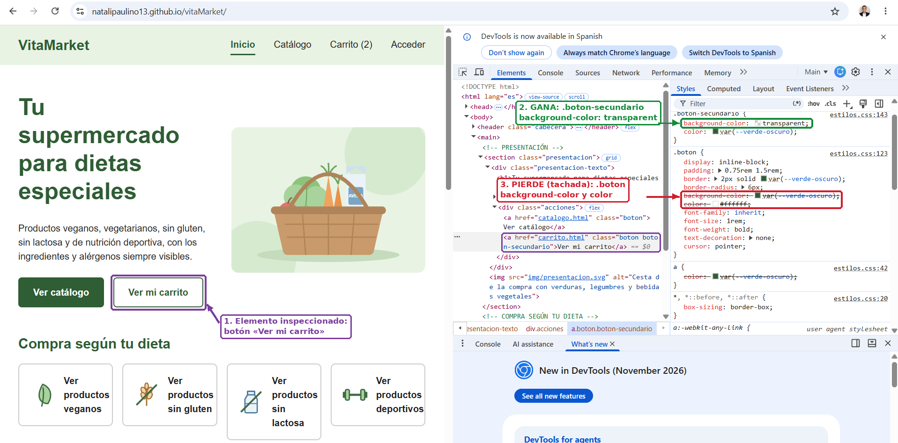
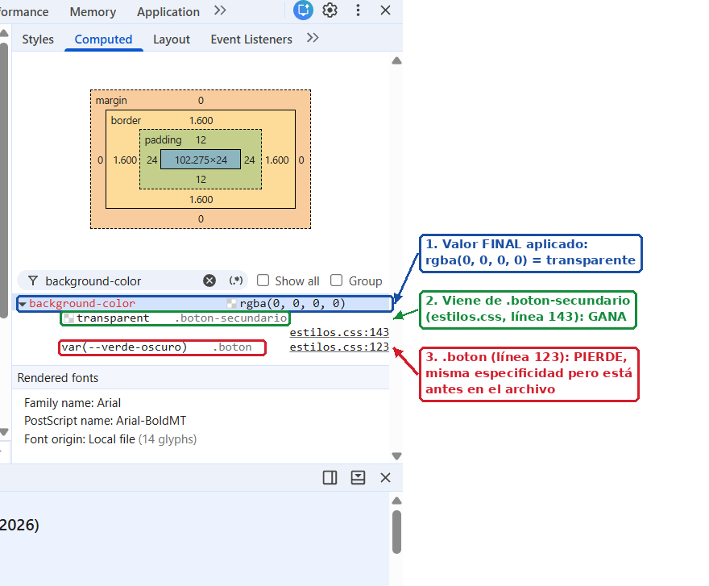

# Comprobaciones con DevTools

Comprobaciones realizadas en Google Chrome sobre la web publicada en GitHub Pages.

## 1. Regla sobrescrita (cascada)

## 1. Regla sobrescrita (cascada)

**Elemento:** botón «Ver mi carrito» de la página de inicio (`<a class="boton boton-secundario">`).

**Qué he comprobado:** el botón tiene dos clases y las dos reglas definen `background-color` y `color`:

- `.boton` (línea 123): fondo `var(--verde-oscuro)` y texto blanco.
- `.boton-secundario` (línea 143): fondo `transparent` y texto `var(--verde-oscuro)`.

Las dos reglas tienen la **misma especificidad** (una clase), así que gana la que aparece **más abajo** en la hoja de estilos: `.boton-secundario`. En el panel *Styles*, las propiedades de `.boton` aparecen tachadas. En *Computed*, el valor final de `background-color` es `rgba(0, 0, 0, 0)` (transparente) y procede de `.boton-secundario`.

También aparece tachado `color` en la regla `a`: pierde porque un selector de clase es **más específico** que un selector de etiqueta.

**Conclusión:** la variante `.boton-secundario` reutiliza todos los estilos de `.boton` (tamaño, borde, tipografía) y solo sobrescribe el fondo y el color del texto.

## 2. Modelo de caja de un componente

*(Pendiente)*

## 3. Distribución con Grid en el inspector

*(Pendiente)*